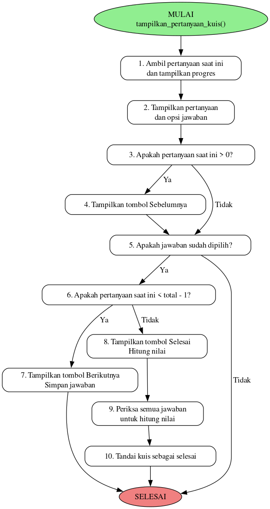

# Dokumentasi Whitebox Testing - Quiz Application

## Deskripsi Aplikasi
Aplikasi Quiz adalah aplikasi web berbasis Streamlit yang memungkinkan pengguna untuk:
- Mengikuti quiz pilihan ganda
- Mengelola soal (tambah, edit, hapus)
- Melihat hasil dan analisis jawaban
- Navigasi antar halaman menggunakan sidebar

## Fungsi yang Dianalisis
Untuk whitebox testing, saya akan menganalisis fungsi `load_questions()` dan `show_quiz_question()` karena memiliki struktur kontrol yang kompleks dan kritis untuk aplikasi.

## 1. Flow Graph

### Flow Graph untuk fungsi `load_questions()`


### Flow Graph untuk fungsi `show_quiz_question()`



## 2. Jalur Independen

### Untuk fungsi `load_questions()`:

**Jalur 1:** start → n1 → n2 → n3 → end
- File exists dan berhasil dimuat tanpa error

**Jalur 2:** start → n1 → n4 → end  
- File tidak exists, langsung create default questions

**Jalur 3:** start → n1 → n2 → n5 → n6 → n7 → end
- File exists tapi terjadi exception saat loading

### Untuk fungsi `show_quiz_question()`:

**Jalur 1:** start → n1 → n2 → n3 → n4 → n5 → n6 → n7 → end
- Previous button ditampilkan, answer selected, not last question, next button

**Jalur 2:** start → n1 → n2 → n3 → n5 → n6 → n8 → n9 → n10 → end  
- No previous button, answer selected, last question, finish button

**Jalur 3:** start → n1 → n2 → n3 → n5 → end
- No previous button, no answer selected

**Jalur 4:** start → n1 → n2 → n3 → n4 → n5 → end
- Previous button shown, no answer selected

## 3. Cyclomatic Complexity

### Untuk fungsi `load_questions()`:

**Perhitungan Decision Points:** V(G) = D + 1
- Decision point 1: `if os.path.exists(self.data_file)` → 2 cabang (True/False)
- Decision point 2: `try-except` untuk JSON decode/file error → 2 cabang (Success/Exception)
- Total decision points: **D = 2**
- **V(G) = 2 + 1 = 3**

**Verifikasi dengan Formula E-N+2P:**
- Nodes (N) = 8: start, n1(check file), n2(read file), n3(set questions), n4(create default), n5(exception), n6(error display), n7(create default), end
- Edges (E) = 9: start→n1, n1→n2(True), n1→n4(False), n2→n3(Success), n2→n5(Exception), n3→end, n4→end, n5→n6, n6→n7, n7→end
- P (connected components) = 1
- **V(G) = 9 - 8 + 2(1) = 3** ✓

### Untuk fungsi `show_quiz_question()`:

**Perhitungan Decision Points:** V(G) = D + 1
- Decision point 1: `if current_q > 0` → 2 cabang (True/False)
- Decision point 2: `if answer` → 2 cabang (True/False)  
- Decision point 3: `if current_q < total_q - 1` → 2 cabang (True/False)
- Total decision points: **D = 3**
- **V(G) = 3 + 1 = 4**

**Verifikasi dengan Formula E-N+2P:**
- Nodes (N) = 11: start, n1(get question), n2(display), n3(check current_q>0), n4(show previous), n5(check answer), n6(check last question), n7(next button), n8(finish button), n9(calculate score), n10(set finished), end
- Edges (E) = 13: start→n1, n1→n2, n2→n3, n3→n4(True), n3→n5(False), n4→n5, n5→n6(True), n5→end(False), n6→n7(True), n6→n8(False), n7→end, n8→n9, n9→n10, n10→end
- P (connected components) = 1
- **V(G) = 13 - 11 + 2(1) = 4** ✓

## 4. Test Cases berdasarkan Jalur Independen

### Test Cases untuk `load_questions()`:

**TC1 - Jalur 1 (File exists, valid JSON):**
```python
def test_load_questions_valid_file():
    # Setup: Create valid questions.json file
    # Execute: Call load_questions()
    # Verify: st.session_state.questions loaded correctly
```

**TC2 - Jalur 2 (File doesn't exist):**
```python
def test_load_questions_no_file():
    # Setup: Ensure questions.json doesn't exist
    # Execute: Call load_questions()
    # Verify: Default questions created
```

**TC3 - Jalur 3 (File exists, invalid JSON):**
```python
def test_load_questions_invalid_json():
    # Setup: Create invalid JSON file
    # Execute: Call load_questions()
    # Verify: Error displayed, default questions created
```

### Test Cases untuk `show_quiz_question()`:

**TC4 - Jalur 1 (Middle question with answer):**
```python
def test_show_quiz_middle_question():
    # Setup: Set current_question = 1, total questions = 3
    # Execute: Show question with answer selected
    # Verify: Previous and Next buttons shown
```

**TC5 - Jalur 2 (Last question with answer):**
```python
def test_show_quiz_last_question():
    # Setup: Set current_question = 2, total questions = 3
    # Execute: Show question with answer selected
    # Verify: Previous and Finish buttons shown
```

**TC6 - Jalur 3 (No answer selected):**
```python
def test_show_quiz_no_answer():
    # Setup: Any question, no answer selected
    # Execute: Show question
    # Verify: No Next/Finish button active
```

## 5. Basis Path Testing

Berdasarkan cyclomatic complexity yang telah dihitung dengan konsisten:
- Fungsi `load_questions()`: **V(G) = 3** → minimum **3 test cases**
- Fungsi `show_quiz_question()`: **V(G) = 4** → minimum **4 test cases**

Total minimum test cases untuk mencapai 100% branch coverage: **7 test cases**

## 6. Kesimpulan Analisis

- **Kompleksitas sedang**: Cyclomatic complexity 3-4, menunjukkan kode cukup mudah dipahami dan ditest
- **Struktur kontrol jelas**: Kondisi if-else dan exception handling terdefinisi dengan baik  
- **Coverage requirement**: Total 7 test cases minimum untuk full path coverage
- **Risk areas**: Exception handling pada file loading dan validasi state quiz
- **Konsistensi perhitungan**: Kedua metode (E-N+2P dan D+1) memberikan hasil yang sama dan konsisten
