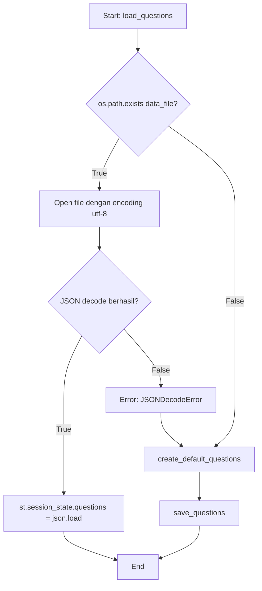
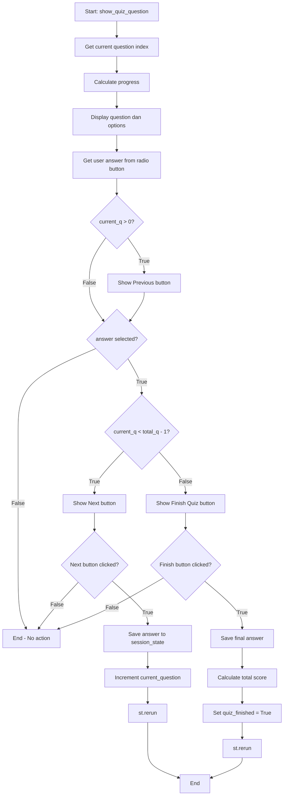
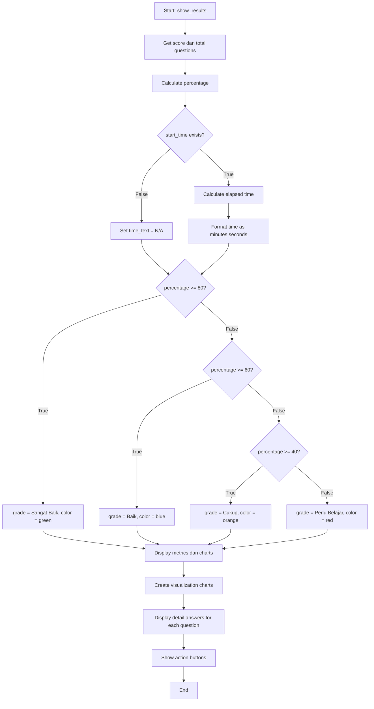
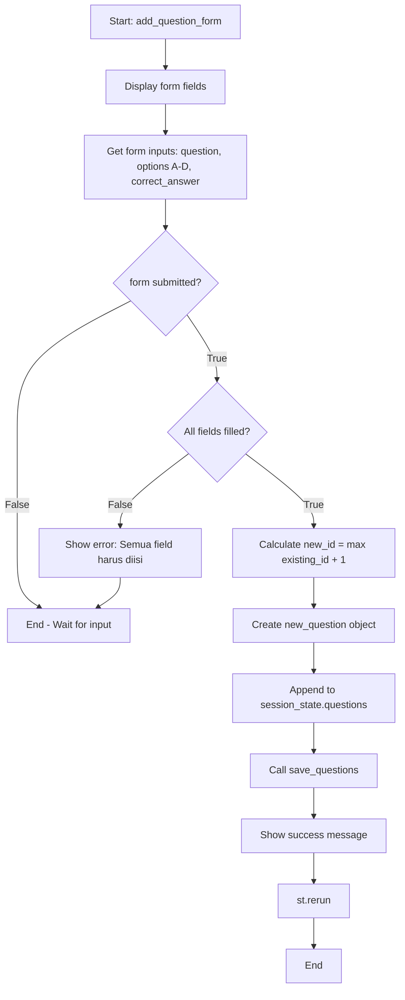

# Dokumentasi Whitebox Testing - Quiz App

## 1. Flow Graph

Berdasarkan analisis kode `streamlit_quiz_app.py`, berikut adalah flow graph untuk fungsi-fungsi utama:

### 1.1 Flow Graph - Fungsi `load_questions()`

### 1.2 Flow Graph - Fungsi `show_quiz_question()`

### 1.3 Flow Graph - Fungsi `show_results()`

### 1.4 Flow Graph - Fungsi `add_question_form()`

## 2. Jalur Independen

### 2.1 Jalur Independen untuk `load_questions()`

**Jalur 1:** A → B → C → E → F → H
- File exists, JSON decode berhasil

**Jalur 2:** A → B → C → E → G → D → I → H  
- File exists, JSON decode gagal, create default

**Jalur 3:** A → B → D → I → H
- File tidak exists, create default

### 2.2 Jalur Independen untuk `show_quiz_question()`

**Jalur 1:** A → B → C → D → E → F → H → J
- current_q = 0, no answer selected

**Jalur 2:** A → B → C → D → E → F → G → H → I → K → M → J
- current_q > 0, answer selected, not last question, next not clicked

**Jalur 3:** A → B → C → D → E → F → G → H → I → K → M → O → Q → S → U
- current_q > 0, answer selected, not last question, next clicked

**Jalur 4:** A → B → C → D → E → F → G → H → I → L → N → J
- current_q > 0, answer selected, last question, finish not clicked

**Jalur 5:** A → B → C → D → E → F → G → H → I → L → N → P → R → T → V → U
- current_q > 0, answer selected, last question, finish clicked

**Jalur 6:** A → B → C → D → E → F → H → I → K → M → O → Q → S → U
- current_q = 0, answer selected, not last question, next clicked

**Jalur 7:** A → B → C → D → E → F → H → I → L → N → P → R → T → V → U
- current_q = 0, answer selected, last question, finish clicked

### 2.3 Jalur Independen untuk `show_results()`

**Jalur 1:** A → B → C → D → E → G → H → I → K → P → Q → R → S
- start_time exists, percentage >= 80

**Jalur 2:** A → B → C → D → F → H → J → L → K → P → Q → R → S  
- start_time not exists, 60 <= percentage < 80

**Jalur 3:** A → B → C → D → E → G → H → J → M → N → K → P → Q → R → S
- start_time exists, 40 <= percentage < 60

**Jalur 4:** A → B → C → D → F → H → J → M → O → K → P → Q → R → S
- start_time not exists, percentage < 40

### 2.4 Jalur Independen untuk `add_question_form()`

**Jalur 1:** A → B → C → D → E
- Form not submitted

**Jalur 2:** A → B → C → D → F → G → E
- Form submitted, fields not complete

**Jalur 3:** A → B → C → D → F → H → I → J → K → L → M → N
- Form submitted, all fields complete

## 3. Cyclomatic Complexity

### 3.1 Perhitungan Cyclomatic Complexity

Rumus: **V(G) = E - N + 2P**
- E = Jumlah edges (panah)
- N = Jumlah nodes (titik/kotak)  
- P = Jumlah komponen terpisah (biasanya 1)

Atau bisa menggunakan: **V(G) = Jumlah decision points + 1**

### 3.2 Complexity untuk setiap fungsi:

#### `load_questions()`
- Decision points: 2 (os.path.exists, JSON decode berhasil)
- **V(G) = 2 + 1 = 3**
- Kategori: **Low complexity** (mudah untuk test dan maintain)

#### `show_quiz_question()`  
- Decision points: 5 (current_q > 0, answer selected, current_q < total-1, next clicked, finish clicked)
- **V(G) = 5 + 1 = 6**
- Kategori: **Moderate complexity** (memerlukan testing yang lebih teliti)

#### `show_results()`
- Decision points: 4 (start_time exists, percentage >= 80, percentage >= 60, percentage >= 40) 
- **V(G) = 4 + 1 = 5**
- Kategori: **Moderate complexity**

#### `add_question_form()`
- Decision points: 2 (form submitted, all fields filled)
- **V(G) = 2 + 1 = 3** 
- Kategori: **Low complexity**

#### `edit_question_form()`
- Decision points: 3 (questions exist, form submitted, all fields filled)
- **V(G) = 3 + 1 = 4**
- Kategori: **Low complexity**

#### `delete_question_form()`
- Decision points: 2 (questions exist, delete button clicked)
- **V(G) = 2 + 1 = 3**
- Kategori: **Low complexity**

### 3.3 Total Application Complexity
- **Rata-rata complexity: 4.0**
- **Complexity tertinggi: 6** (show_quiz_question)
- **Status: Maintainable** - Sebagian besar fungsi memiliki complexity rendah hingga sedang

### 3.4 Rekomendasi
1. **show_quiz_question()** memiliki complexity tertinggi (6) - pertimbangkan refactoring untuk memisahkan logic navigation dan answer handling
2. Fungsi-fungsi lain sudah cukup sederhana dan mudah untuk di-test
3. Prioritas testing tertinggi pada fungsi dengan complexity >= 5
4. Implementasi unit test minimal untuk semua jalur independen yang telah diidentifikasi
